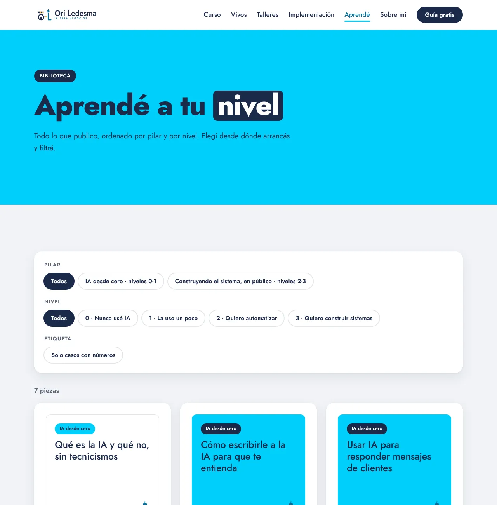

# oriledesma.com

The website of **Ori Ledesma · IA para negocios**, a Spanish-language brand that teaches small business owners to use AI, tested first on its own business. It's a statically prerendered React site plus a small Node API for lead forms and course seats. I also use it as a public example of how I structure, test and ship frontend work.


_Home page: prerendered HTML, self-hosted variable font and an AVIF hero photo (LCP under 0.5 s in Lighthouse)._

## Quick start

Prerequisites: Node 22 (`nvm use`) and npm 10.

```bash
npm install
npm run dev
```

- Web: http://localhost:5173
- API: http://localhost:3001

No keys are needed in development: without them the API uses in-memory adapters and writes notifications to the log. Every variable is listed, with comments, in `apps/api/.env.example` and `apps/web/.env.example`.

| Command                                       | What it does                                                    |
| --------------------------------------------- | --------------------------------------------------------------- |
| `npm run dev`                                 | API and web with hot reload                                     |
| `npm test`                                    | Unit and integration tests in every workspace                   |
| `npm run test:e2e`                            | Playwright against the production build and the real API        |
| `npm run lint` / `typecheck` / `format:check` | Static checks run by CI                                         |
| `npm run build`                               | Builds every workspace                                          |
| `npm run images -w @oriledesma/web`           | Regenerates AVIF/WebP variants, optimized SVGs and the OG image |

## Architecture

```
┌──────────────────────────┐        ┌──────────────────────────┐
│ apps/web                 │  JSON  │ apps/api                 │
│ React Router 8 (SSG)     │ ─────▶ │ Fastify 5                │
│ Cloudflare Pages         │        │ Render                   │
└────────────┬─────────────┘        └────────────┬─────────────┘
             │      packages/schemas (Zod)       │
             └──────── one contract, both sides ─┘
```

**Static first.** Every page is prerendered to HTML at build time (`ssr: false` + `prerender`). The marketing site needs SEO and speed, not a server. The FAQ is built on `<details>`, so it works even before JavaScript loads. If the course platform needs authenticated, server-rendered routes, switching to `ssr: true` is a config change, not a rewrite.

**One contract.** `packages/schemas` holds the Zod schemas for every form, the error shape and the route names. The web validates with the same schema the API enforces, so the two can't drift apart. Validation errors travel as stable codes (`invalid_email`, `too_long`), and the web translates them into the active language.

**State lives where it belongs:**

- **Server state** (course seats, form submissions) goes through TanStack Query.
- **URL state** holds the library filters (`/aprende?pilar=sistema&nivel=2`), so a filtered view can be shared and survives a refresh.
- **Local state** is used only for UI, such as the open/closed menu.

**Ports and adapters in the API.** Routes depend on interfaces (`EmailList`, `Notifier`, `SeatsProvider`), not on vendors. `container.ts` chooses MailerLite or in-memory, Resend or log, based on which keys are set. The payment provider (Stripe or Lemon Squeezy) is still undecided. When it is chosen, it plugs into `SeatsProvider` without touching routes or the web.

**Surface-aware design tokens.** The brand palette lives in `tokens.css`. `surfaces.css` maps each section background (`niebla`, `blanca`, `celeste`, `noche`) to semantic variables such as `--c-btn-bg`. A `<Button>` adapts to the section it sits in through inherited custom properties, without selectors like `.dark .button`. Components use CSS Modules and never hardcode a color.

## File structure

```
apps/
├── web/
│   └── app/
│       ├── routes/        # thin route modules: meta + page component
│       ├── features/      # one folder per page or domain (home, course, learn, leads, analytics…)
│       ├── shared/        # ui/, forms/, media/, api/, seo/, lib/: no feature imports
│       ├── content/       # typed, schema-validated static content
│       ├── i18n/          # es/en dictionaries for the site chrome
│       ├── config/        # site settings and named routes
│       └── styles/        # tokens, surfaces, base
└── api/
    └── src/
        ├── modules/       # leads and course routes
        ├── integrations/  # ports + MailerLite, Resend, seats adapters
        ├── plugins/       # error handler
        └── config/        # validated environment
packages/
└── schemas/               # Zod contracts shared by web and API
e2e/                       # Playwright specs
```

## Testing

```bash
npm test            # Vitest: schemas, API and web
npm run test:e2e    # Playwright: desktop + mobile, Chromium
```

The suite tests behavior, not implementation. Each layer covers a different risk:

- **Schemas:** normalization, error codes and limits.
- **API:** every endpoint through `fastify.inject`, including validation, rate limiting, security headers and upstream failures. The adapters are tested against a mocked `fetch`, including HTML escaping in notification emails.
- **Web:** React Testing Library with MSW, so components hit a real network layer. Form tests cover client validation, server validation, rate limits and offline errors. Every page runs `axe` in jsdom.
- **End to end:** Playwright runs against the production build, served the way Cloudflare Pages serves it, and the real API. It covers navigation, forms, URL filters, no-JavaScript rendering and WCAG 2.1 AA checks with `@axe-core/playwright` (color contrast included, which jsdom can't check).
- **Lighthouse CI:** fails a PR if performance drops below 95, accessibility below 100, LCP above 2.5 s or CLS above 0.1.


_`/aprende`: filters are plain query parameters, read only after hydration so the static HTML stays valid._

## Accessibility

- A skip link and a single `<main>` on every page.
- One `h1` per page and no skipped heading levels. The mockup had a few skips, which are fixed here.
- The mobile menu sets `aria-expanded`, moves focus into the menu, closes with Escape and returns focus to the button.
- Form fields are wired with `useId`: label, hint and error are linked to the control. Focus moves to the first invalid field.
- The success message takes focus; errors use `role="alert"`.
- Toggle filters use `aria-pressed` and the result count is announced through a live region.
- `prefers-reduced-motion` turns off smooth scrolling and transitions.


## Performance

- The Jost variable font is self-hosted: Latin subsets only, with the Latin file preloaded.
- Photos are AVIF and WebP with `srcset`. The hero photo is `fetchpriority="high"` and everything else lazy-loads.
- The SVG logos are optimized with SVGO.
- Hashed assets are cached as immutable (`_headers`).
- No client-side data is needed for first paint: the seat counter renders from config and updates once the API answers.

## Trade-offs & decisions

- **React Router in framework mode over Next.js.** It gives static prerendering and a clear path to SSR with a smaller runtime and plain Vite. Cost: a smaller ecosystem of hosting presets.
- **A static site plus a separate API, instead of a full-stack framework.** The web deploys to a CDN with no server, and the API scales and fails on its own. Cost: two deploys and CORS configuration.
- **CSS Modules + custom properties over Tailwind.** The brand already had a token system, and surfaces need cascading context, which custom properties handle natively. Cost: more CSS files.
- **`'unsafe-inline'` in the CSP `script-src`.** React Router hydrates with an inline context script. A nonce needs a server, which a static host doesn't have; generating hashes at build time is the next step.
- **No database yet.** Leads go to MailerLite and inquiries go out by email. Postgres + Drizzle will come with the course platform, behind the same port/adapter boundary.
- **Content as typed files, not a CMS.** It's validated by a test, so a typo in a level or pillar fails CI. When someone other than a developer needs to edit content, it can move to a headless CMS without changing components.
- **Deliberately skipped:** real checkout (the provider isn't chosen yet), the Instagram and YouTube feeds (placeholders for now) and authentication.

Code comments are in Spanish, the product's language; this README is in English for a wider audience.

## Deployment

- **Web → Cloudflare Pages.**
  - Build command: `npm run build -w @oriledesma/web`
  - Output directory: `apps/web/build/client`
  - Environment variables: `VITE_API_URL`, `VITE_GA_MEASUREMENT_ID`
  - The build also generates `404.html` and `sitemap.xml`; old `.html` URLs redirect with a 301.
- **API → Render** through the `render.yaml` Blueprint. Secrets are entered in the Render dashboard, not stored in the repo.
- **CI** (GitHub Actions) runs on every PR: lint, format, typecheck, unit tests, build, Conventional Commits, Playwright and Lighthouse.

## AI usage

I built this with Claude as a pair programmer under my direction. I set the constraints: stack, architecture rules, testing strategy, accessibility baseline and commit conventions. Claude produced the components, tests and configuration within them, and compared the result visually against the original mockup. I reviewed the decisions and the code; the architecture and trade-offs are mine.
